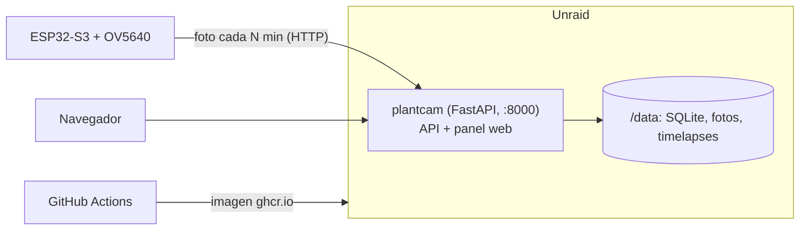

# PlantCam

Un ESP32-S3 con cámara OV5640 fotografía tus plantas a intervalos regulares y un servidor propio guarda las fotos,
genera timelapses diarios y semanales y los muestra en un panel web. Pensado para uno o varios dispositivos.

## Cómo funciona

- El ESP32 hace una foto cada N minutos dentro de una ventana horaria (por ejemplo, de día) y la sube por HTTP al
  servidor. Puede ir enchufado o con pilas (duerme entre fotos).
- Los ajustes (intervalo, horario, resolución, modo de energía) se cambian desde el panel; el dispositivo los lee antes
  de cada foto.
- En el panel, cada dispositivo tiene su galería por días con la hora de cada foto, un visor a pantalla completa y un
  ajuste para girar la imagen si la cámara está montada de lado (lo aplica el servidor; el original no se toca).
- El servidor genera un timelapse por día (00:05) y otro por semana (domingo 00:15) con ffmpeg, y también bajo demanda
  desde el panel; los automáticos se pueden desactivar por dispositivo y los timelapses se pueden borrar. Solo entran
  las fotos dentro del horario.
- Las fotos se borran solas pasado el plazo que elijas por dispositivo (de 1 semana a 1 año, o nunca; 14 días por
  defecto), y también se pueden borrar a mano, una a una o un día entero. Los timelapses se conservan.
- El horario lo hace cumplir el servidor con su hora local: aunque el reloj de la placa falle, fuera de horario no
  dispara.
- Un dispositivo nuevo se da de alta solo en su primer arranque: configuras su WiFi desde el móvil y listo.



## Componentes

| Carpeta | Qué es |
|---------|--------|
| `firmware/` | PlatformIO, framework Arduino, ESP32-S3 (16 MB de flash, 8 MB de PSRAM) |
| `backend/` | FastAPI, SQLAlchemy, SQLite, Alembic, APScheduler, ffmpeg y Pillow. También sirve el panel |
| `frontend/public/` | Panel en HTML y JavaScript sin build |
| `unraid/` | Plantilla del formulario de Docker de Unraid |
| `.github/workflows/` | Prueba y publica la imagen Docker en ghcr.io |

## Empezar

1. [Desplegar el servidor en Unraid](docs/DEPLOY.md)
2. [Flashear el ESP32 y darlo de alta](docs/FIRMWARE.md)

Las decisiones de diseño, endpoints y trampas conocidas están en [CLAUDE.md](CLAUDE.md), escrito para que cualquiera
(persona o agente) se ponga al día sin leer todo el código.

## Desarrollo en local

```bash
cd backend
python -m venv .venv
.venv/Scripts/python -m pip install -r requirements.txt
.venv/Scripts/python -m alembic upgrade head
.venv/Scripts/python -m uvicorn app.main:app --port 8000
```

Abre `http://localhost:8000/`: el mismo proceso sirve el panel y la API. En desarrollo el login es `admin` / `admin`
(la imagen Docker exige secretos propios). Los timelapses necesitan `ffmpeg` en el PATH. Para el firmware, `cd firmware`
y `.venv/Scripts/python -m platformio run` compila sin necesitar la placa.

## Limitaciones conocidas

- Necesita buena cobertura WiFi de 2,4 GHz: con señal débil (-70 dBm en la primera prueba) las fotos no llegan, aunque
  el dispositivo salga "En línea".
- Con poca luz las fotos muestran bandas verticales y ruido.
- Los timelapses ya generados no cambian si después se cambia la rotación: hay que volver a generarlos.
- El reset de fábrica (BOOT) borra también el alta: el dispositivo reaparece en el panel como uno nuevo.
- No hay botón para borrar dispositivos.
- La zona horaria del firmware es un valor fijo sin cambio de horario automático.
