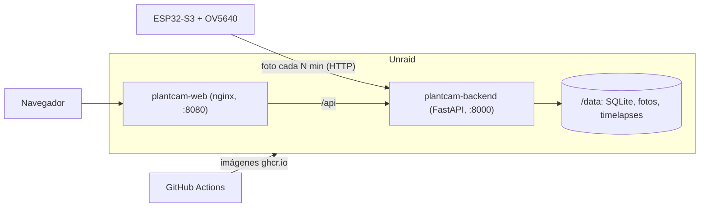

# PlantCam

Un ESP32-S3 con cámara OV5640 fotografía tus plantas a intervalos regulares y un servidor propio guarda las fotos,
genera timelapses diarios y semanales y los muestra en un panel web. Pensado para uno o varios dispositivos.

## Cómo funciona

- El ESP32 hace una foto cada N minutos dentro de una ventana horaria (por ejemplo, de día) y la sube por HTTP al
  backend. Puede ir enchufado o con pilas (duerme entre fotos).
- Los ajustes (intervalo, horario, resolución, modo de energía) se cambian desde el panel; el dispositivo los lee tras
  cada foto.
- El backend genera un timelapse por día (00:05) y otro por semana (domingo 00:15) con ffmpeg, y también bajo demanda
  desde el panel. Las fotos originales se purgan tras el timelapse semanal.
- Un dispositivo nuevo se da de alta solo en su primer arranque: configuras su WiFi desde el móvil y listo.



## Componentes

| Carpeta | Qué es |
|---------|--------|
| `firmware/` | PlatformIO, framework Arduino, ESP32-S3 (16 MB de flash, 8 MB de PSRAM) |
| `backend/` | FastAPI, SQLAlchemy, SQLite, Alembic, APScheduler, ffmpeg |
| `frontend/` | Panel en HTML y JavaScript sin build, servido por nginx |
| `.github/workflows/` | Prueba y publica las imágenes Docker en ghcr.io |

## Empezar

1. [Desplegar el servidor en Unraid](docs/DEPLOY.md)
2. [Flashear el ESP32 y darlo de alta](docs/FIRMWARE.md)

Las decisiones de diseño, endpoints y trampas conocidas están en [CLAUDE.md](CLAUDE.md), escrito para que cualquiera
(persona o agente) se ponga al día sin leer todo el código.

## Desarrollo en local

```bash
cd backend
python -m venv .venv
.venv/Scripts/python -m pip install -r requirements.txt
.venv/Scripts/python -m alembic upgrade head
.venv/Scripts/python -m uvicorn app.main:app --port 8000
```

En desarrollo el login del panel es `admin` / `admin` (la imagen Docker exige secretos propios). Los timelapses
necesitan `ffmpeg` en el PATH. Para el firmware, `cd firmware` y
`.venv/Scripts/python -m platformio run` compila sin necesitar la placa.

## Limitaciones conocidas

- El firmware está verificado solo por compilación: falta la prueba con la placa real (portal cautivo, cámara, subida).
- Si el portal WiFi o el alta en el servidor fallan, el dispositivo no reintenta solo hasta que se reinicia.
- No hay botón para borrar dispositivos, ni pantalla para cambiar la retención de fotos.
- La zona horaria del firmware es un valor fijo sin cambio de horario automático.
